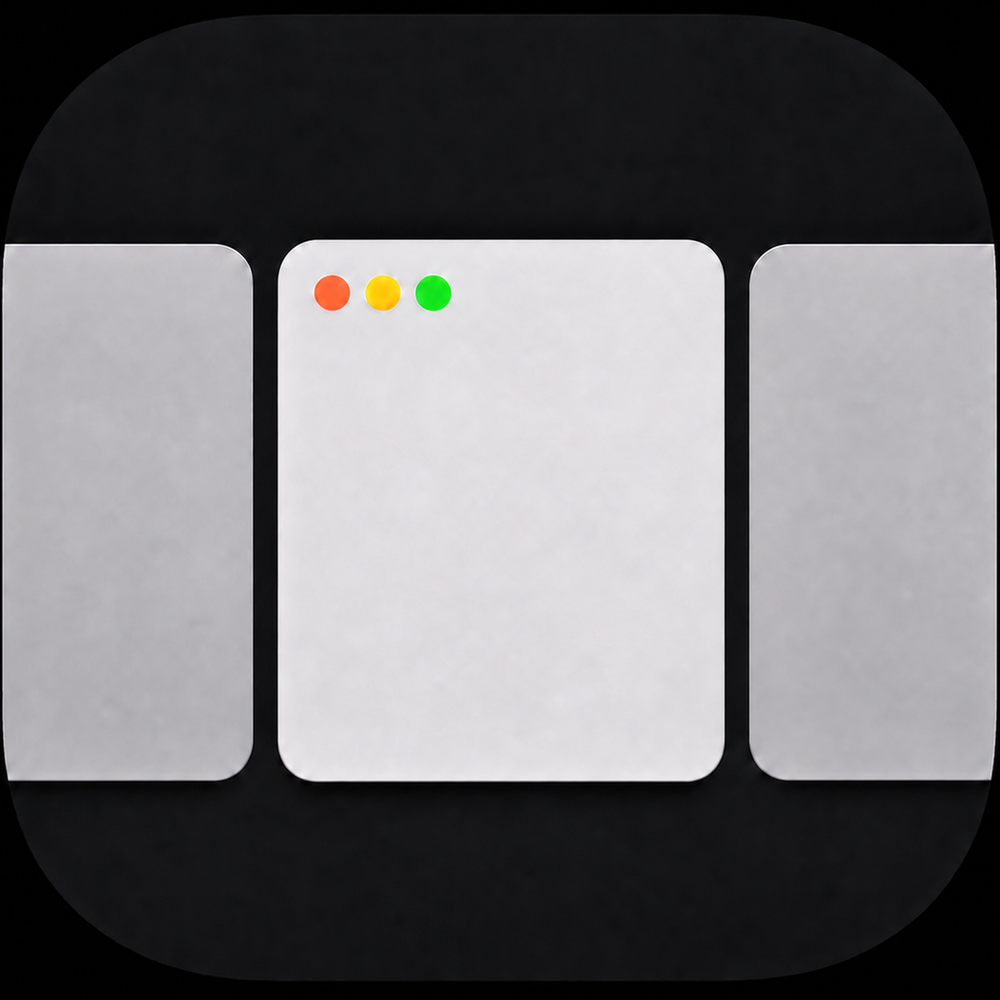
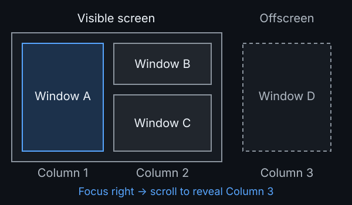
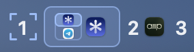

<div align="center">



# miri

[](./LICENSE)

[Watch the demo video](https://dimixar.github.io/miri/assets/repo/demo.html)

_Niri-ish, keyboard-first window management for macOS._

</div>

miri arranges app windows in horizontally scrolling columns. Navigate by
keyboard, group windows into stacked rows, and switch between virtual
workspaces without entering native macOS fullscreen.

Inspired by [Niri](https://github.com/YaLTeR/niri) and the archived
[`maria-rcks/miri`](https://github.com/maria-rcks/miri), this project is maintained
independently and is no longer a fork.

## Status

miri is **source-first**: build with Swift or package a local app using the
commands below. GitHub Releases are not currently provided.

It is designed and tested for **one MacBook built-in display**. External and
multi-display configurations are outside the current scope and untested.

## Features

- **Scrolling columns and optional stacks.** Resize columns and independently
  adjust the heights of up to three windows in each column.
- **Focus alignment.** Reveal the focused window with minimal scrolling, always
  center it, or use Smart Centered to keep visible windows stationary and fit a
  neighbor when possible. See [alignment rules](docs/configuration.md#layout).
- **Virtual workspaces.** Each keeps its own focus and scroll position, with
  separate state for inferred native macOS Spaces.
- **Floating and workspace fullscreen.** Untile an individual window or let it
  fill the usable workspace without creating a macOS Space.
- **Persistent layouts.** Restore column order, widths, and focus across restarts,
  with window restoration on quit and crash cleanup.
- **Optional snapshot animations.** Animate movement and resizing using captured
  window images, not live video.
- **Window rules.** Match apps or window titles to control tiling, placement,
  and width.
- **Recovery and app isolation.** Handle lock/sleep and window lifecycle changes;
  an unresponsive app does not block window management for healthy apps.

## How The Layout Works



New windows open in separate columns. Moving focus to an offscreen column
scrolls the view to reveal it. Miri workspaces are virtual layouts, distinct
from native macOS Spaces.

Stacking is off by default. Enable two or three rows in **Settings → Layout →
Stacked columns**, then use `LAlt+Shift+H` / `LAlt+Shift+L` to join windows.
Stacked windows share a column width but can have different heights.

## Requirements

- macOS 26 or newer.
- To build from source: Xcode 26 or newer (macOS SDK 26 or newer and a Swift 6
  toolchain).
- Accessibility permission for window management.
- Input Monitoring permission may be needed for the `event_tap` shortcut
  backend and for detecting managed-window interaction after session recovery.
- Screen Recording permission is needed for snapshot animations.

First-run onboarding checks permissions and lets you choose alignment, margins,
and animations before tiling starts. If Screen Recording access requires a
restart, setup resumes at the same step.

If you run miri from a terminal, macOS may request permissions for that terminal
app rather than for a packaged `Miri.app`. See
[permission troubleshooting](docs/troubleshooting.md#permissions).

## Install And Run

Build and run from source:

```bash
git clone https://github.com/dimixar/miri.git
cd miri
swift run miri
```

Build an optimized binary:

```bash
swift build -c release
.build/release/miri
```

## Packaging Locally

Build a local `.app` bundle:

```bash
scripts/package-app.sh
open dist/Miri.app
```

Build a local Apple Silicon macOS DMG:

```bash
scripts/package-macos.sh --version 0.1.0
open dist/Miri-0.1.0-arm64-darwin.dmg
```

## Default Shortcuts

Default shortcuts use **left Option** (`lalt`). Everything else passes through
unless configured otherwise.

| Shortcut | Action |
| :-- | :-- |
| `LAlt+1`..`LAlt+9` | Focus workspace by dynamic index |
| `LAlt+0` | Focus previous workspace |
| `LAlt+J` / `LAlt+K` | Focus row down / up; hold at the edge to change workspace |
| `LAlt+H` / `LAlt+L` | Focus column left / right |
| `LAlt+[` / `LAlt+]` | Focus first / last column |
| `LAlt+Home` / `LAlt+End` | Focus first / last column |
| `LAlt+Shift+1`..`LAlt+Shift+9` | Move column to workspace |
| `LAlt+Shift+J` / `LAlt+Shift+K` | Reorder row down / up; hold at the edge to move that window to another workspace |
| `LAlt+Shift+H` / `LAlt+Shift+L` | Move focused window into the adjacent column or a new column |
| `LAlt+Shift+[` / `LAlt+Shift+]` | Move column to first / last |
| `LAlt+Shift+F` | Toggle workspace fullscreen |
| `LAlt+Ctrl+F` | Toggle focused window floating/tiled |
| `LAlt+Ctrl+J` / `LAlt+Ctrl+K` | Smaller / larger row height preset (no wrapping) |
| `LAlt+Ctrl+H` / `LAlt+Ctrl+L` | Cycle active column width preset |
| `LAlt+Ctrl+-` / `LAlt+Ctrl+=` | Nudge active column width |
| `LAlt+Ctrl+Shift+H` / `LAlt+Ctrl+Shift+L` | Cycle every tiled window width preset |
| `LAlt+Ctrl+Shift+-` / `LAlt+Ctrl+Shift+=` | Nudge every tiled window width |

Shortcut handling can use either a CG event tap or Carbon registered hot keys.
See [Configuration](docs/configuration.md#shortcuts).

Workspace boundary holds default to **750ms**. Release cancels; each crossing
requires a fresh press. Explicit older bindings are preserved. Change or disable
bindings in **Settings → Shortcuts**; the reference covers
[stacking, fullscreen, floating, and legacy bindings](docs/configuration.md#shortcuts).

## Menu Bar And Settings



The active workspace expands into app icons; inactive workspaces show their
number and last-focused app, if any. Appearance and colors are
[configurable](docs/configuration.md#menu-bar).

Open **Settings…** from the menu bar to edit the active JSON config and reload
in place. The menu also offers config access, window rescanning, permission
recovery, and **Quit Miri** with window restoration.

For a packaged, code-signed app, enable **Settings → General → Startup → Launch
at login** after onboarding. This native macOS preference applies immediately,
independently of saving the config. Only one Miri instance runs per user.

## Session Lock And Sleep Recovery

miri pauses while locked, asleep, or outside the active desktop session. After
unlock or wake, click, scroll, or type in a managed window to resume tracking;
a registered Miri hot key with a managed window focused also works. If no
windows are known, recovery starts automatically. See
[recovery troubleshooting](docs/troubleshooting.md#miri-appears-paused-after-unlock-or-wake)
and the [recovery sequence](docs/architecture.md#session-availability-flow).

## Configuration

miri selects the first existing config path from:

1. `MIRI_CONFIG`
2. `./miri.config.json`
3. `$XDG_CONFIG_HOME/miri/config.json`
4. `~/.config/miri/config.json`

A malformed selected file reports an error and does not silently fall through
to a lower-priority path. Hot reload keeps the last known-good config active.

The repository includes a complete default [`miri.config.json`](miri.config.json).
See [Configuration](docs/configuration.md) for setting descriptions, focus
alignment modes, shortcut backend tradeoffs, active-rescan reliability settings,
rule syntax, and menu bar options.

## Notes And Limitations

- Native macOS Space handling is inferred from visible windows. If two Spaces
  expose indistinguishable window sets, miri may not be able to tell them apart.
- Apps with incomplete Accessibility support can behave unpredictably. Active
  rescans help with missed events but cannot fix incorrect window data; use
  [ignore rules](docs/configuration.md#window-rules) for persistently problematic
  apps. Disabling active rescans can reduce idle CPU and battery use.
- Mission Control and native fullscreen transitions may need a later rescan.
- Window control is primarily Accessibility-based, but miri uses private APIs
  and undocumented macOS contracts for narrow gaps. These may change between
  macOS releases. See the [API scope and fallbacks](docs/architecture.md#private-and-undocumented-api-scope).
- Keep verbose debug logging disabled outside investigation sessions.

## Documentation

- [Configuration](docs/configuration.md): layout, rules, shortcuts, and appearance.
- [Troubleshooting](docs/troubleshooting.md): permissions, recovery, and app issues.
- [Architecture](docs/architecture.md): code structure, event flow, and API usage.
- [Window discovery and reconciliation](docs/window-discovery-and-reconciliation.md).
- [Snapshot animation](docs/snapshot-animation.md).
- [Documentation index and historical research](docs/README.md).
